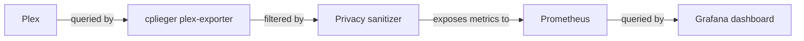

# Architecture

This project connects its data source to its Grafana dashboard through the components shown below.

## Overview

This diagram shows the data path for this project.



## Components

### Data source

Plex -> cplieger/plex-exporter -> sanitizer removes or aggregates session identity labels -> authenticated /metrics -> Prometheus -> Grafana.

### Dashboard

`dashboards/plex-application.json` contains the Grafana dashboard definition.

## Data flow

Plex -> cplieger/plex-exporter -> sanitizer removes or aggregates session identity labels -> authenticated /metrics -> Prometheus -> Grafana. Grafana evaluates dashboard queries against the selected data source and label values.

## Directory layout

```text
.
├── dashboards/  Grafana dashboard JSON files
├── sanitizer/  Plex metrics sanitizer
├── examples/  Scrape and deployment examples
├── docs/        Documentation source
└── README.md    Project overview and quick links
```
